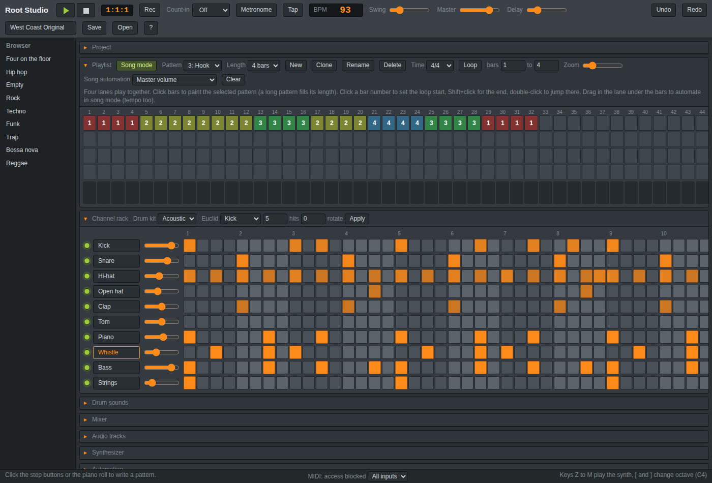
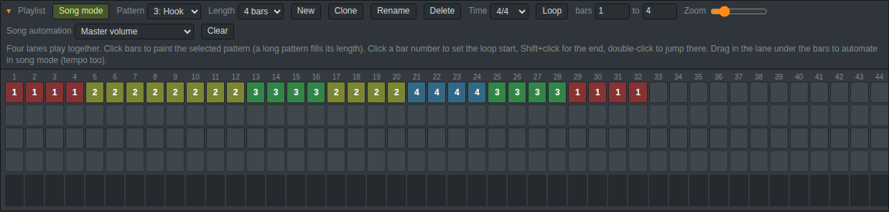
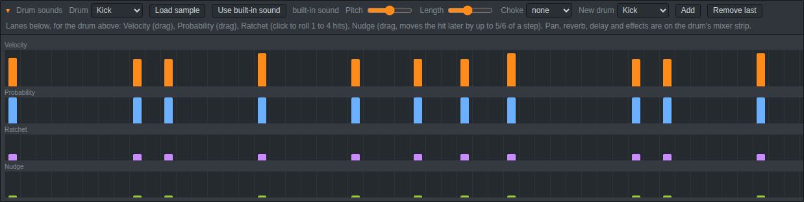
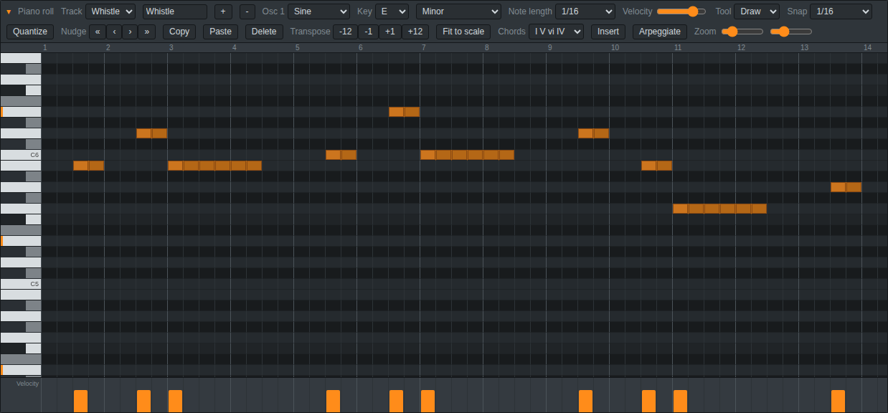
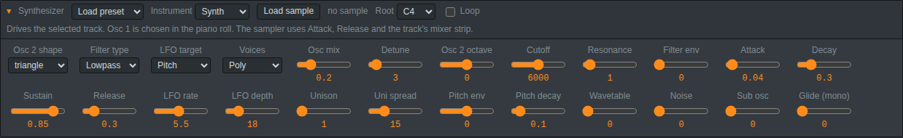
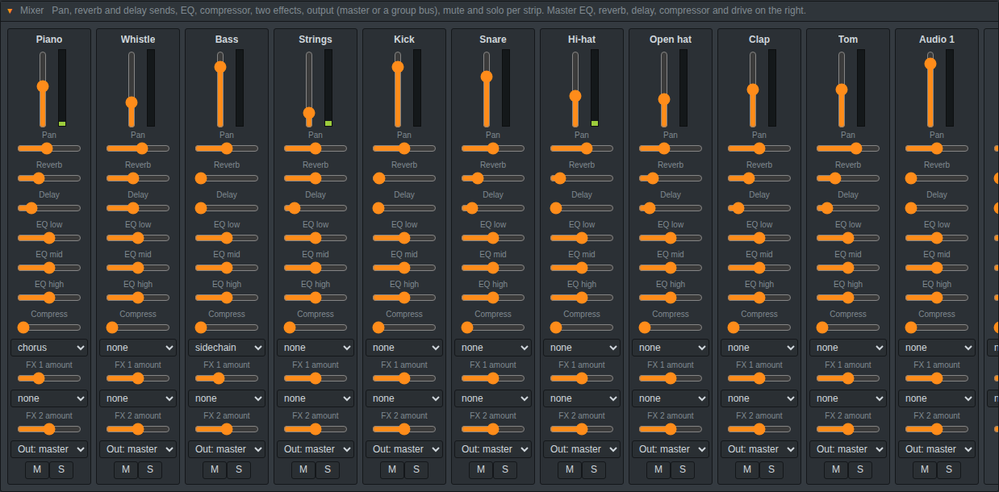

# Root Studio

*A browser-based music maker that is free. Without installing anything, create beats, compose melodies, record your voice, and export the music.*

<p align="center">
  
</p>

## How to run it

open **https://slimshadyxroot1-png.github.io/Root-Studio/** in your Browser

Or to run it locally

```
git clone https://github.com/slimshadyxroot1-png/Root-Studio.git
```

And run index.html file

## Why I made this

I loved creating music but i realized that most DAWs were very expensive and heavy, and they didn't work on low-end computers so i decided to create an open source DAW that runs on a browser.

## Quick start

1. Open the app. A basic beat is already loaded.
2. Press **Space** to play.
3. Click the squares in the **Channel rack** to add drum hits.
4. Click in the **Piano roll** to add notes.
5. Change the BPM, swing and master volume at the top.
6. Click **Save** to keep the song, or **Export WAV** to get the audio.

The list on the left has presets (Rock, Techno, Funk, Trap and more).

## What's inside

Click the title of any panel to fold it.

<p align="center">
  
</p>

**Playlist.** Turn patterns into a whole song. There are four lanes that play at the same time and 128 bars. You can loop a part, and you can draw automation under the bars, even tempo changes.

<p align="center">
  
</p>

**Drums.** Six drums to start, up to 12. You can load your own samples, change pitch and length, and make drums cut each other off (like a closed hi-hat stopping an open one). Each hit can have its own velocity, chance of playing, roll and small timing shift.

<p align="center">
  
</p>

**Piano roll.** Draw notes, pick a key and scale so you can see which notes fit, insert chord progressions, and snap to triplets and 1/32 notes. Play it with your computer keyboard (Z, S, X, D, C, V...) or a MIDI keyboard. Turn on **Rec** to record what you play.

<p align="center">
  
</p>

**Synthesizer.** Two oscillators, a sub, noise, a filter, an LFO and presets. A track can also be a sampler that plays your own sound at any pitch.

<p align="center">
  
</p>

**Mixer.** Volume, pan, EQ, a compressor, reverb and delay sends, two effects and group buses for every track. There's also a master section on the right.

**Audio tracks.** Record from the microphone or load audio files, then cut, stretch, fade and reverse them. With a loop on, every pass you record becomes its own take.

## Example beats

The `beats` folder has three beats I already made. Each one comes as a `.json` song and as a `.wav` file.

| Beat | BPM |
|---|---|
| Drill Nights | 140 |
| Midnight Keys | 64 |
| West Coast Original | 93 |

- **Just listen:** play the `.wav` file on your computer or phone, no app needed.
- **Play with it:** open Root Studio, click **Open** and pick one of the `.json` files (or drag it onto the page). Then press **Song mode** and **Space** to hear the whole song, and change anything you like.

## License

[MIT](LICENSE). Free for everyone to use, change and share however they want.
